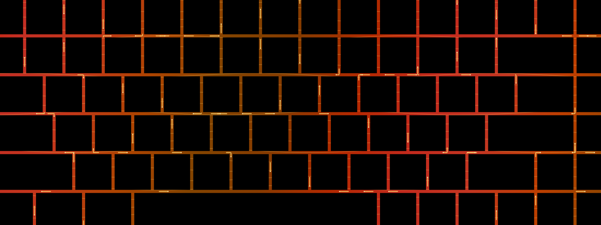

# KeyBloom · 键下生花

透明屏幕键盘的开源互动壁纸。按下实体键，图案从对应键位下方出现；点按立即响应，长按持续触发。

基于 **[Lively Wallpaper](https://github.com/lively-community/lively)** 运行。Lively 提供桌面承载、多屏管理和自定义设置；本项目提供实体键位映射、动画、游戏与后台按键转发。独立社区项目，与 Lively 官方无隶属关系。

- [下载 v1.2.0 壁纸 ZIP](downloads/KeyBloom-IPI84-v1.2.0.zip)
- [Lively 官方下载](https://github.com/lively-community/lively/releases)
- [完整使用说明](wallpaper/使用说明.md)
- [测试与资源占用说明](docs/PERFORMANCE.md)

## v1.2.0

- 分区设置：动画、游戏、夹缝灯效、触发、声音、背景、校准。
- 玻璃碎裂：每次敲击产生不同分叉、暗边和细亮边，旧裂纹保留，连续输入增加损伤，松开后修复。
- 活字印刷：实体键位下方压印字模，随机墨点与轻微偏转。
- 键帽夹缝：RGB 流水、清水、熔岩、光流迷宫，可叠加到动画或游戏，宽度/亮度/速度可调。
- 本地合成音效，可关闭，默认关闭。不需要音频素材或联网。
- 默认参数来自实际校准与调节：黑底、60 FPS、照明 100、范围 270%、速度 200%、长按等待 40 ms、间隔 210 ms。
- 默认保留玻璃动画，新增夹缝灯效关闭；画面不显示提示、注释或键名。




## 安装

Windows x64，Lively WebView2 网页播放器。将下载的 ZIP 直接拖入 Lively，选中实际键盘屏并应用。点“…”→“打开文件所在位置”，运行导入目录中的 `KeyBloomInput.exe`，即可在其他窗口打字时响应。

导入 ZIP 不会自动启动后台组件。要随登录启用，运行同目录 `Enable-KeyboardInteraction.ps1`；停止并取消登录启动，运行 `Disable-KeyboardInteraction.ps1`。Lively 自身也要设置随系统启动。更换副本前关闭旧副本。

默认校准用于 IPI 84（16u × 6 行）。换电脑后确认显示器编号，在“实体键位校准”区调整中心与键距；四边允许出界。其他键盘布局需修改 `wallpaper/layout.js`。

## 自定义

先选择“当前分类”，再选择对应区的“动画效果”或“游戏”。夹缝灯效独立叠加。背景亮度设为 0 为纯黑；调为 100 并选择纯白即可使用白底。默认帧率为用户选择的 60，可调至 30 或 15 降低绘制开销。

原有八种玩法保留，新增活字印刷；共七种动画与两种游戏。点按立即触发，长按持续；修饰键与多键独立响应。自定义改变玩法或重新加载会清空临时游戏状态。

静态无动画时停止绘制；动态背景、游戏、夹缝流动和玻璃修复时持续刷新。本版本没有开启硬件关屏或显示器禁用；单屏休眠/唤醒尚待实体设备验证。黑色像素不等于背光断电。

## 构建与测试

网页无 npm 依赖，无远程字体、音频或网络服务。直接打开 `wallpaper/index.html` 可预览；普通网页只在获得焦点时接收键盘。

```powershell
powershell -File scripts/build.ps1
```

使用 Windows 自带 .NET Framework x64 编译器，输出 `dist/KeyBloom-IPI84-v1.2.0.zip`。

```sh
node tests/games.cjs
node tests/surfaces.cjs
```

`tests/interaction.cjs`、`tests/power-light.cjs` 和 `tests/surfaces-browser.cjs` 是 Playwright 页面检查函数。通过请求拦截提供 `wallpaper/` 的静态文件后运行；无外部服务器依赖。覆盖点按/长按、参数边界、随机裂纹、修复、夹缝裁切、分类切换、音效开关和空闲停绘。

## 许可与隐私

GPL-3.0，见 [LICENSE](LICENSE)。Lively 的官方来源和许可见 [THIRD_PARTY_NOTICES.md](THIRD_PARTY_NOTICES.md)。分享包不附带 Lively 安装器，使用上述官方链接获取。

后台组件只向本壁纸转发即时按下/松开，不保存按键内容、不转成文字、不联网。正常输入仍进入前台应用；这不是键盘拦截器。Fn 层由固件决定。未在其他电脑完整安装实测，未测量实际瓦数。
