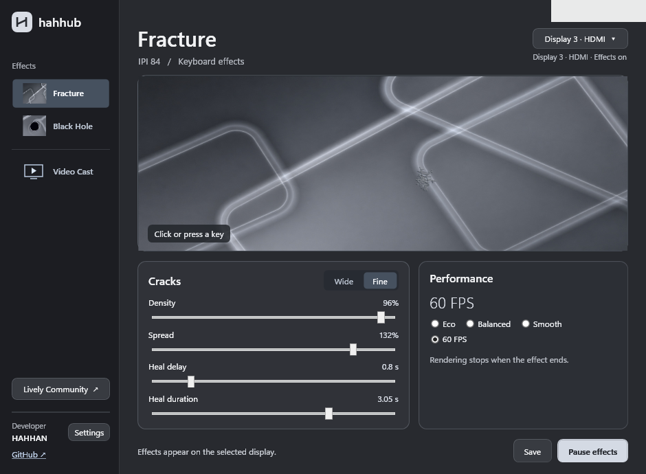

# hahhub

hahhub turns a transparent keyboard display into a live surface for your keystrokes. Press a key on an IPI 84 and ice grows from the keycap edge, spiders follow the seams, or a black hole pulls the picture inward. You can also cast video to the keyboard display and use the same effects on the moving picture.

[Download for Windows x64](https://github.com/dotohua009/Hahhub-lively/releases/latest/download/hahhub-windows-x64.zip) · [Releases](https://github.com/dotohua009/Hahhub-lively/releases) · [Source and build instructions](hahhub/) · [简体中文](#简体中文)

## PowerShell 一行安装 · Windows x64

打开 PowerShell，复制下面一行，粘贴后按回车。安装完成后，从桌面打开 **hahhub**。手动升级前，先从托盘退出旧版。

Paste this line into PowerShell and press Enter. It downloads the current release, verifies the package and installs it for your Windows user.

```powershell
irm https://raw.githubusercontent.com/dotohua009/Hahhub-lively/main/install.ps1 | iex
```



## Effects and video

| Library | Effects |
| --- | --- |
| Materials | Glitter Flow, Fracture, Ink Splash, Prism |
| Weather | Frost Fog, Snowdrift, Frost Lance |
| Creatures | Tendrils, Silk Colony |
| Energy | Black Hole, Voxel Fuse |

Tap different sides of the keyboard to draw the reflective liquid across the board. Hold a key to frost its surface, grow an irregular cluster of ice spikes, or weave a web that draws spiders through the gaps. Voxel Fuse lets you set the delay before nearby blocks set each other off.

- **Fracture** starts a crack at the calibrated switch position. Hold to extend it, press a nearby key to influence its path, and release to let it heal in reverse after an adjustable delay.
- **Black Hole** pulls the live image into a rotating, irregular opening. Adjacent keys merge their holes. Hold for about 4.7 seconds to swallow the display, then release to let the picture return.
- **Ink Splash** sprays while you hold a key. Most droplets bounce off the keycap and a few escape. Adjust spray range and how long the ink takes to clear after release.
- **Edge glow** lets you pick independent colors for Fracture and Black Hole.
- **Video Cast** plays a Bilibili video page or a direct MP4, WebM or M4V link on one selected extended display. Playback controls stay in hahhub. The active effect samples the video while third-party wallpaper sampling is paused.

## Get started

1. Extract the Windows ZIP and run `powershell -ExecutionPolicy Bypass -File .\install.ps1` from its folder. Video playback uses Microsoft Edge WebView2 Runtime.
2. Open **hahhub**, select the keyboard display and choose **Enable effects**. In **Settings → Keyboard alignment**, align the keycap, switch housing and stem outlines to the physical keyboard. Save adjustments for the whole layout or an individual key on the selected display. You can choose any extended display by name.
3. Minimize or close the panel to keep it in the system tray. Double-click the **H** icon to reopen it, or use **Quit hahhub** to stop the app and its renderer.

Choose **Settings → Language** for English or 简体中文. **Settings → Updates** checks the public update channel and installs a verified package in place. Display selection, effect settings and language are kept across updates.

## 简体中文

hahhub 是为透明屏键盘制作的 Windows 桌面程序。1.1.0 收录 11 种效果，分为材质、气象、生物和能量。流麻会流向敲得更频繁的一侧，霜雾从整块键帽散开，冰刺从边缘几个随机位置分批长出。选中键盘屏后，实体按键会在对应位置生成沿画面生长的裂纹，让周围纹理卷入黑洞，或从轴芯持续喷墨。泼墨范围和恢复时间可调，碎裂与黑洞支持独立设置辉光色。进入「设置 → 键位校准」，可分别对齐键帽、轴体和轴芯，每个显示器独立保存。视频上屏支持同一组交互，播放进度条和按钮放在控制面板里。最小化或点 × 后，视频和交互继续在托盘运行。

[下载 Windows x64 版](https://github.com/dotohua009/Hahhub-lively/releases/latest/download/hahhub-windows-x64.zip) · [中文使用说明](hahhub/README.md) · [KeyBloom「键下生花」旧版壁纸、下载与说明](KEYBLOOM.md)

Developed by **HAHHAN**. Licensed under GPL-3.0. [Third-party notices](hahhub/NOTICE.md)
